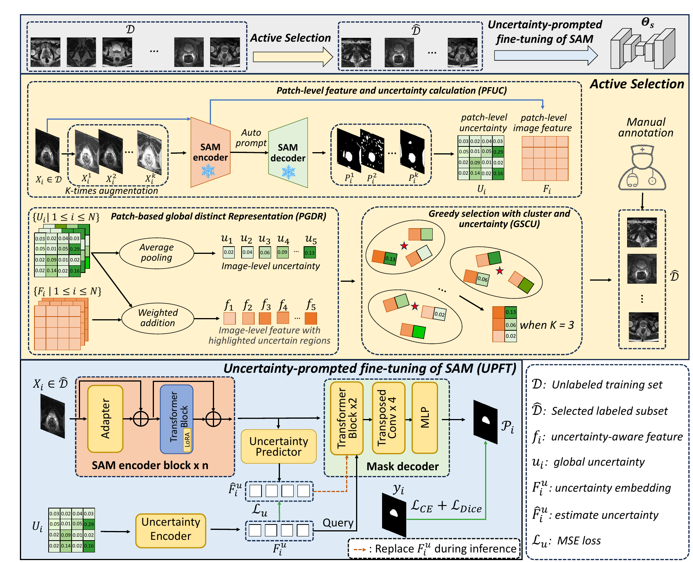
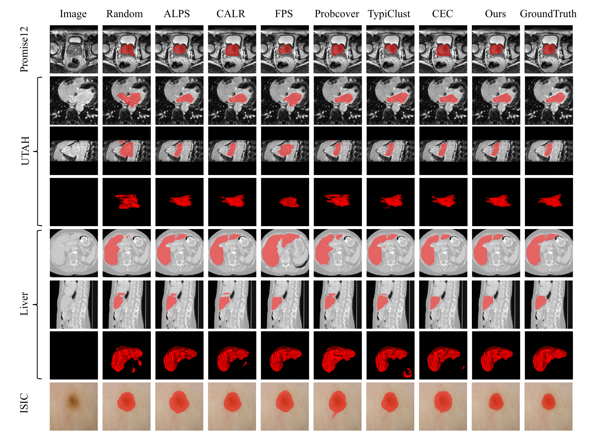

# SUGFW+

<p align="center">
  <strong>An Uncertainty-guided Feature Weighting Framework for Cold Start Active Adaptation of SAM in Medical Image Segmentation</strong>
</p>

<p align="center">
  Xiaochuan Ma · Ning Zhu · Jia Fu · Lanfeng Zhong · Hanyu Jiang · Bin Song · Kang Li · Guotai Wang
</p>

<p align="center">
  <a href="#overview">Overview</a> ·
  <a href="#method">Method</a> ·
  <a href="#results">Results</a> ·
  <a href="#environment">Environment</a> ·
  <a href="#dataset-and-preprocessing">Data</a> ·
  <a href="#usage">Usage</a> ·
  <a href="#citation">Citation</a>
</p>

Official implementation of **SUGFW+**, a cold start active learning (CSAL) framework that selects a small, informative subset from an entirely unlabeled medical image dataset and then adapts the Segment Anything Model (SAM) using only the selected annotations.

## Overview

Medical image segmentation normally requires expensive dense annotations. Cold start active learning reduces this burden by selecting a useful query set in a single round, without relying on an initial labeled subset. Existing approaches commonly train a dataset-specific self-supervised model for feature extraction and separate sample selection from downstream model training.

SUGFW+ instead uses SAM throughout the complete pipeline:

1. **SUGFW for sample querying** extracts patch-level SAM features and uncertainty, builds uncertainty-aware image representations, and selects samples by jointly considering diversity and uncertainty.
2. **UPFT for model adaptation** uses the estimated uncertainty as a spatial prompt to fine-tune SAM effectively under an extremely limited annotation budget.

### Main contributions

- A unified framework that uses SAM for both cold-start sample selection and downstream segmentation model adaptation.
- An uncertainty-aware query strategy composed of **PFUC**, **PGDR**, and **GSCU**, designed to select representative and informative samples without target-domain labels.
- An **Uncertainty-Prompted Fine-Tuning (UPFT)** strategy that replaces manual prompts with uncertainty guidance and learns from a very small annotated subset.
- State-of-the-art CSAL performance across prostate MRI, left-atrium MRI, liver CT, and dermoscopic skin-lesion segmentation datasets.

## Method

<p align="center">
  
</p>

SUGFW+ contains two connected stages.

### 1. SUGFW: uncertainty-guided sample querying

- **Patch-level Feature and Uncertainty Calculation (PFUC).** SAM's image encoder produces patch-level features. Its automatic mask generation mode is applied to multiple augmented views of each image, and the entropy of the averaged predictions provides a patch-level surrogate uncertainty map.
- **Patch-based Global Distinct Representation (PGDR).** Patch features are aggregated with uncertainty-dependent weights, highlighting ambiguous and semantically informative regions in the resulting image-level representation. Average-pooled patch uncertainty is retained as an image-level uncertainty score.
- **Greedy Selection with Cluster and Uncertainty (GSCU).** Images are clustered in the uncertainty-aware feature space. A greedy strategy then selects one sample from each cluster while covering different uncertainty levels, balancing representativeness, diversity, and informativeness.

### 2. UPFT: uncertainty-prompted SAM adaptation

The selected samples are manually annotated and used to adapt SAM. UPFT replaces SAM's original prompt encoder with an uncertainty encoder and injects the uncertainty embedding into the mask decoder as a spatial prompt. A lightweight uncertainty predictor learns to estimate this embedding directly from image features, avoiding repeated augmented inference at test time. The image encoder is adapted with LoRA, while the mask decoder, uncertainty encoder, and uncertainty predictor remain trainable.

## Results

SUGFW+ was evaluated with Dice Similarity Coefficient (DSC) and 95th-percentile Hausdorff Distance (HD95). At the lowest annotation budget reported for each dataset, it achieved:

| Dataset | Target | Modality | Annotation budget | DSC (%) |
|---|---|---|---:|---:|
| Promise12 | Prostate | T2-weighted MRI | 3.00% | **86.38** |
| UTAH | Left atrium | MRI | 0.10% | **78.70** |
| MSD Liver | Liver | CT | 0.05% | **82.27** |
| ISIC 2018 | Skin lesion | Dermoscopy | 0.50% | **86.36** |

Across the evaluated budget ranges, SUGFW+ consistently outperformed the compared cold-start active learning methods. The full study reports annotation ratios of 3–8% for Promise12, 0.10–0.75% for UTAH, 0.05–0.30% for MSD Liver, and 0.5–3.0% for ISIC 2018, with no more than 100 annotated slices or images per dataset.

### Qualitative comparison

<p align="center">
  
</p>

Compared with Random, ALPS, CALR, FPS, ProbCover, TypiClust, and CEC, SUGFW+ produces more complete and anatomically consistent segmentations under very limited supervision.

## Repository structure

```text
SUGFW+/
├── UC-SAM/          # PFUC uncertainty estimation and active sample selection
├── MA-SAM-un/       # UPFT-based SAM training and inference
├── preprocessing/   # Dataset conversion and split generation
├── checkpoint/      # SAM ViT-B checkpoint
├── data/            # Prepared datasets (created by the user)
└── assets/figures/  # Figures used by this README
```

## Environment

```sh
conda create -n SUGFW+ python=3.10
conda activate SUGFW+

pip3 install torch torchvision torchaudio --index-url https://download.pytorch.org/whl/cu124

cd SUGFW+
pip install -e .
```

The experiments in the paper use PyTorch on Linux with four NVIDIA GeForce RTX 2080 Ti GPUs. The released scripts can be adjusted to match the available GPU configuration.

## Dataset and preprocessing

### 1. Download the SAM checkpoint

Download the SAM ViT-B checkpoint to `./checkpoint`:

```sh
cd ./checkpoint
wget https://dl.fbaipublicfiles.com/segment_anything/sam_vit_b_01ec64.pth
cd ..
```

### 2. Download the datasets

Download the datasets from their official websites:

- [Promise12](https://promise12.grand-challenge.org/Home/)
- [UTAH Left Atrium](https://www.cardiacatlas.org/atriaseg2018-challenge/)
- [MSD Liver](http://medicaldecathlon.com/)
- [ISIC 2018](https://challenge.isic-archive.com/data/#2018)

Place each downloaded dataset under:

```text
./data/{Dataset}/raw
```

Run the corresponding preprocessing and CSV-generation scripts:

```sh
cd ./preprocessing
python {Dataset}_pre.py
python {Dataset}_csv.py
```

Replace `{Dataset}` with the script prefix available in `preprocessing/`, for example `Promise12`, `UTAH`, `Liver`, or `ISIC`.

All images or 3D slices are resized to `512 × 512` during preprocessing. The 3D datasets are queried and trained at the slice level because the released framework uses 2D SAM.

## Usage

The complete workflow first estimates uncertainty and selects the query set with SUGFW, and then trains and evaluates the UPFT-based SAM model.

### 1. Obtain uncertainty and select samples

```sh
cd ./UC-SAM
bash command/get_un_Promise12.sh
python get_avg_un.py
python select_samples.py
```

Dataset paths, checkpoint paths, augmentation count, annotation budget, and GPU IDs can be configured in the corresponding command scripts and Python arguments.

### 2. Training and inference

```sh
cd ../MA-SAM-un
bash command/Promise12/run_my.sh
```

The provided Promise12 command performs both model training and inference. Update the paths, queried CSV name, GPU IDs, and annotation-budget settings in the shell script before launching a new experiment.

## Citation

```bibtex
@inproceedings{ma2025sugfw,
  title={Sugfw: A sam-based uncertainty-guided feature weighting framework for cold start active learning},
  author={Ma, Xiaochuan and Fu, Jia and Zhong, Lanfeng and Zhu, Ning and Wang, Guotai},
  booktitle={International Conference on Medical Image Computing and Computer-Assisted Intervention},
  pages={579--588},
  year={2025},
  organization={Springer}
}

@article{ma2026sugfw+,
  title={SUGFW+: An Uncertainty-guided Feature Weighting Framework for Cold Start Active Adaptation of SAM in Medical Image Segmentation},
  author={Ma, Xiaochuan and Zhu, Ning and Fu, Jia and Zhong, Lanfeng and Jiang, Hanyu and Song, Bin and Li, Kang and Wang, Guotai},
  journal={arXiv preprint arXiv:2608.16110},
  year={2026}
}
```
